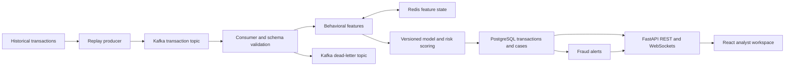

# Architecture

## Phase 1

The monorepo stores one Python manifest and lockfile. Each developer has an isolated virtual environment. Directories represent planned component boundaries. Runtime services begin after offline scoring has been validated.

## Target transaction flow

## Design boundaries

- **Offline ML.** Use Python, NumPy, Pandas, scikit-learn, XGBoost, LightGBM, imbalanced-learn, SHAP, Matplotlib, and Seaborn as the training and analysis phases require them. Fit learned preprocessing on training data only. Select hyperparameters and operating thresholds on validation. Evaluate the selected configuration against the held-out test data.
- **Event contract.** Version the message schema and preserve source, event ID, and event time. Use deterministic ordering for equal timestamps and define late-event behavior before releasing streaming. Replace full card identifiers with keyed pseudonyms before publishing application events. Historical features use earlier state and exclude the current event.
- **Processing and recovery.** Partition Kafka events by pseudonymous card key. Use a unique event identifier in PostgreSQL and commit Kafka offsets after durable processing. Design Redis state updates with per-event deduplication and a rebuild path from durable events. Retry transient failures with bounded backoff. Route invalid and exhausted events to a dead-letter topic with redacted diagnostics.
- **Persistence and delivery.** PostgreSQL owns scores, case state, and audit records. Store model version and decision threshold alongside the score. Add indexes for chronological browsing, risk filters, and pseudonymous history, then check query plans. Use a durable alert outbox to close the gap between persisting a score and publishing its alert. REST supports snapshots and case actions. WebSockets deliver live updates and clients recover missed events through REST.
- **Application.** FastAPI uses Pydantic for validation and SQLAlchemy for persistence. React uses TypeScript, Tailwind CSS, Recharts, and Lucide. Keep simulated, predicted, and confirmed outcomes distinguishable in APIs, reports, and the UI.
- **Operations.** MLflow tracks runs and model versions. Evidently measures input and score drift against a reference window. Drift signals and confirmed-label performance have distinct reporting. Use Docker Compose for local services and GitHub Actions for automated verification. Verify CPU-compatible dependencies on Apple Silicon before claiming support for each later phase.
